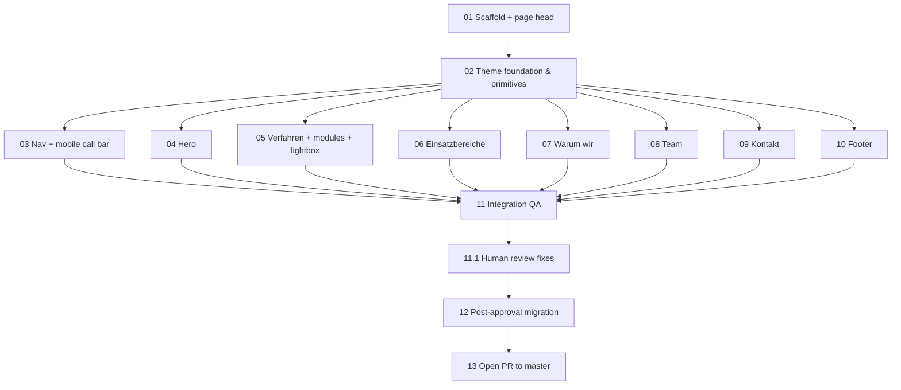

# design-v2 — Parallelisation map (when to fan out agents)

**Audience:** the agent running the *next* session.
**Purpose:** the 13 tickets in `.scratch/design-v2/issues/` are ordered so that some of them can be
worked by multiple agents at once. This file says exactly **when that is safe, which tickets may run
together, and what breaks if you fan out too early.**

**Companion docs:** `DESIGN_PLAN.md` (decision log, read first), `AGENTS.md` (commands + deploy
hazard), `docs/agents/issue-tracker.md` (`Status:` line protocol).

---

## 1. The dependency graph



Read as **six waves**. Only wave 3 is genuinely parallel; everything else is one agent, alone.

---

## 2. Waves

| Wave | Tickets | Agents | Why |
| --- | --- | --- | --- |
| **1** | `01` | **exactly 1** | Creates branch `design/v2` off `master` @ `e5ffdd6`, the `src/prototype/` tree and the `public/index.html` head. No branch ⇒ nothing to build in, no tree ⇒ no ticket has a home. Nothing can overlap. |
| **2** | `02` | **exactly 1** | Owns `tailwind.config.js`, `src/index.css`, the shared primitives and the showcase. All of `03`–`10` import from it. Two agents here would fork the design vocabulary — precisely the failure `DESIGN_PLAN.md` §4.1 exists to prevent. |
| **3** | `03`–`10` | **1–8** — fan-out permitted, see §3 | Each is blocked *only* by `02`. Eight disjoint sections. **This is the only wave to parallelise.** |
| **4** | `11` | **exactly 1** | Whole-page verification after assembly. Its job is to reconcile the wave-3 outputs, so it cannot itself be split or overlapped. Its output is the evidence the reviewer trusts. |
| **5** | `12` | **exactly 1**, human-gated | Deletes 7 components, moves copy into `data.json`, prunes assets. Needs explicit user approval first. |
| **6** | `13` | **exactly 1**, human-gated | ⛔ **Deploys the live site.** See §5. |

---

## 3. Wave 3: how far you can actually fan out

The graph allows 8 agents. **File ownership, not the graph, is the real limit.**

### Green — safe to run concurrently

Each of `03`–`10` owns its own component file under `src/prototype/`. Given that, all eight may run
at once, provided they respect the red list below.

### Red — serialisation points. Never touched concurrently.

| Artifact | Owner | Rule |
| --- | --- | --- |
| Prototype page shell (the file under `src/prototype/` that composes the sections in §4 order) | `01`, then the coordinator | **The one real collision risk.** Eight agents each adding their section to the same file = guaranteed conflict. |
| `tailwind.config.js`, `src/index.css` | `02` only | A wave-3 agent that needs a new token, colour, shadow or reveal helper **stops and escalates** — it does not edit these. |
| Shared primitives (CTA button, Section, framed card, reveal hook) | `02` only | Same rule. Consume as-is; never fork a local variant. |
| `public/index.html` | `01` only | Head, favicons, OG/Twitter tags are finished there. |
| `src/data/data.json` | `12` only | Wave 3 hardcodes prototype copy — that is expected and avoids every conflict on this file. |

**Resolve the shell *before* fanning out** (pick one, and write down which):

- **A.** `01` pre-creates `src/prototype/sections/` with all eight slots stubbed and the shell already
  importing all eight in §4 order. Then every wave-3 agent edits one file and the shell is frozen.
  ← cleanest.
- **B.** `01` builds the shell with one section; the coordinator wires each new section in as the
  wave-3 agent reports back. Works, but the coordinator must be the only writer.

Without one of these, wave 3 degrades into N agents racing on one file.

### Concurrency cap in practice

Even with clean ownership, cap at **3–4 concurrent agents**, because agents share one working tree:

- `npm start` binds **port 3000** — concurrent dev servers clash.
- `npm run build` writes the shared, gitignored `build/` directory — concurrent builds race.
- Concurrent `git add`/`commit` on one tree means agents commit each other's work-in-progress.

If you want true parallelism beyond that, give each agent its own **git worktree** and its own port
(`$env:PORT=3001`), then merge each branch into `design/v2`. Only worth the overhead if speed matters
more than simplicity — each ticket here is small.

### Known cross-ticket coordination (not a blocker, but verify in `11`)

- `03` and every other section: anchors must land with the heading clear of the sticky nav. `02`
  provides the scroll-margin, but it can only be *verified* once all sections exist — so this is `11`'s
  job, not `03`'s.
- `08` (Team) and `09` (Kontakt): both show Marcus Auner's portrait in the same framed light card.
  They are explicitly built **independently, with no dependency between them**, so the crop values are
  duplicated. `11` must confirm the two crops are identical.
- `03` (nav emblem, CSS crop of `logo.jpg`) and `10` (footer logo plate) both derive from the same
  JPEG. Independent files, but they should read as the same brand.

---

## 4. Protocol while fanned out

1. Read `docs/agents/issue-tracker.md`. Before starting a ticket, set its `Status:` line to
   `claimed` and save — **commit the claim before doing the work**, so two agents never pick the
   same ticket.
2. Set `Status:` to `ready-for-human` (or `wontfix`) only when the ticket genuinely needs a human;
   otherwise leave it for `11`.
3. Ticket `11` is the first ticket whose result a human sees. Findings are **written down, not
   silently fixed**, so the reviewer can see what changed and why.
4. `DESIGN_PLAN.md` §3 is frozen. A wave-3 agent that finds a real conflict with a decision raises it
   with the user instead of changing the decision.
5. Do not open a PR to `master`. Do not push to `master`. Branch pushes are safe (see `AGENTS.md`).

---

## 5. The two human gates — do not automate past them

Both are written into the tickets themselves ("and explicit user approval"), and both are the reason
this map has waves 5 and 6 instead of one long autonomous run.

- **`12` needs approval of the prototype.** It deletes `header.jsx`, `features.jsx`, `about.jsx`,
  `services.jsx`, `Team.jsx`, `contact.jsx`, `Footer.jsx` and prunes images. That is irreversible in
  terms of effort, so it waits for a human "yes" on the rendered page.
- **`13` needs approval before the PR is created** — and is safe to run only as a deliberate,
  attended, single-agent act. `.github/workflows/deploy.yml` triggers on **`pull_request` to
  `master`** as well as on `push`, so **opening** the PR publishes `ingenieurbuero-auner.com`. Never
  hand this ticket to a background or parallel agent, and never create the PR "to see what CI says".

---

## 6. Quick reference

```
wave 1  T01                       1 agent   (hard serial)
wave 2  T02                       1 agent   (hard serial)
wave 3  T03 T04 T05 T06 T07 T08 T09 T10     fan out — see §3 for the cap and the red list
wave 4  T11                       1 agent   (hard serial)
wave 4.1 T11.1                    1 agent   (hard serial — touches Kontakt, Footer, Team, PortraitCard, Section, focus)
wave 5  T12                       1 agent   ✋ needs user approval
wave 6  T13                       1 agent   ⛔ PUBLISHES THE LIVE SITE — needs user approval
```

**Default recommendation:** run waves 1, 2, 4, 5 and 6 as single agents, and fan out wave 3 to at
most 3–4 agents with a pre-wired shell. The graph permits eight; the shared working tree and the
shell file argue against it.
